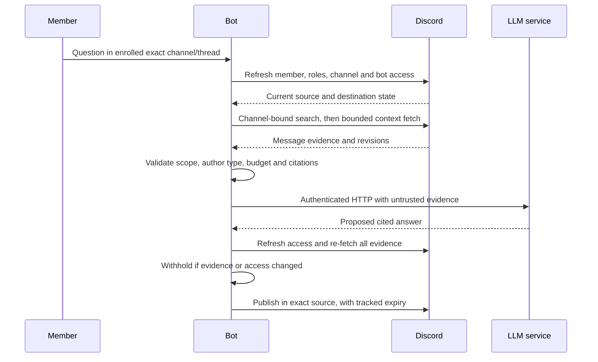

# Discord conversation retrieval proposal

Status: proposed for review, not an accepted implementation decision.
Tracks [#332](https://github.com/UTMIST/Misty/issues/332).
Prepared against staging `a56bde3` on 2026-10-27. No production collection,
permission, retention, or model configuration changes are authorized by this
document. Merging it does not complete #332's requester/reviewer acceptance.

## Problem and proposed first slice

Members need to recover past decisions, their reasons, and later changes with
links to the original messages. A plausible answer without accessible evidence
is worse than an explicit statement that the available history is insufficient.

Recommend evaluating **on-demand Discord search plus bounded context fetch**
before building a conversation index. Keep Discord as the source of truth;
do not create embeddings or durable message snapshots in the first slice.
This recommendation is conditional on app eligibility and the evaluation below.
If it fails either gate, return to review rather than silently starting ingestion.

Proposed pilot, requiring requester and maintainer agreement:

- Enroll named server text channels explicitly, with a visible member notice
  explaining search, model processing, answer copies, removal, and contact owner.
  Bot read access alone never enrolls a channel. Enrollment is guild-specific.
- Retrieve from the exact enrolled channel where the question is asked. Public
  threads under enrolled parents require separate explicit enrollment; search
  and publish only within that exact thread. An automatically created helper
  thread is a different destination: do not copy parent-channel evidence into it.
- Defer private threads, forums/media channels, age-restricted channels, DMs as
  evidence, attachments, embeds, forwarded snapshots, voice, and other guilds.
  Reject unsupported sources even when the bot is an administrator.
- For the pilot, also defer questions asked in DMs and cross-channel answers.
  Later support requires a separate audience policy; a linked directory person
  and directory team memberships do not prove Discord visibility.
- Keep existing document search behavior separate. Do not ingest conversations
  as ordinary Google-granted documents or broaden catalog grants to make it work.

## Evidence and alternatives

The current baseline is recent follow-up context, not historical search:
[`mentions.js`](../discord-bot/src/adapters/discord/mentions.js) fetches at most
100 recent messages plus the starter for a thread, without pagination.
[`helperTools.js`](../discord-bot/src/helperTools.js) already revalidates document
evidence for publication; its pattern is reusable, not its authorization policy.
The [catalog search contract](../services/documentation-system/docs/API.md#authorized-retrieval-post-search)
requires attested person/channel context and filters before ranking limits.
Its Google group model cannot represent Discord role overrides or thread access.

| Option | Strength | Limit / operating burden | Proposed disposition |
| --- | --- | --- | --- |
| Recent-thread baseline | Existing code; little historical data handling | Cannot find discussions outside the recent context | Control for the same evaluation questions |
| On-demand native search + context | No local historical corpus; current source checks; bounded prototype | App access unverified; keyword recall and latency uncertain; Discord index can lag | Evaluate first |
| Persist conversations in documentation-system | Existing lexical/vector retrieval and citations | Needs a new Discord-specific access model, message identity, deletion and reconciliation contracts; ordinary document grants are unsafe | Revisit only if on-demand quality is inadequate |
| Separate conversation service/store | Explicit message, thread and lifecycle model | Additional service, database, migrations, credentials, recovery and owner | Defer until measured scale or lifecycle needs justify it |

Platform evidence checked 2026-10-27:

- Discord documents guild message search, history permission, Message Content
  intent restrictions, and an index-not-ready response requiring delayed retry.
  Search returns matches without surrounding context; fetch context separately.
  Its channel filter must be bound by the adapter, not selected by the model.
  [Message API](https://docs.discord.com/developers/resources/message#search-guild-messages).
- Discord says thread membership can remain after channel access is lost, and
  no thread-delete event signals that loss. A cached thread list is insufficient.
  [Thread access](https://docs.discord.com/developers/topics/threads#losing-access-to-channels).
- Permissions combine guild roles and channel overrides. Resolve effective
  permissions from current membership, roles and channel state, rather than
  trusting a remembered role name.
  [Permissions](https://docs.discord.com/developers/topics/permissions).
- Honor server-provided rate-limit headers and retry delays; do not hard-code
  Discord throughput assumptions.
  [Rate limits](https://docs.discord.com/developers/topics/rate-limits).

These are documented capabilities, not proof that Misty's app has access.
An operator must record a minimal approved app check: app/environment, intent
configuration, permitted test channel, response status/schema and retry behavior.
Do not record bot tokens or real message bodies. No such live check or quality
benchmark has been performed for this proposal.

## Ownership, flow and proposed contracts

The bot owns the Discord adapter, enrollment, audience checks, bounded retrieval
and reply lifecycle. It retains the Discord token. `llm` remains the authenticated
HTTP generation boundary, receiving only approved evidence. Directory linking
keeps the helper's existing caller gate, but does not grant conversation access.
Neither documentation-system nor connectors gains tables or Discord credentials.
No service imports another service's implementation or shares its tables.

Proposed internal interfaces, not new implemented HTTP endpoints:

| Boundary | Input / output | Required invariant |
| --- | --- | --- |
| Adapter to retrieval coordinator | Frozen context: request ID, attested Discord user/guild/exact source and destination IDs, linked person, enrollment revision | Construct from the authenticated event; never from tool arguments |
| Model tool `search_conversations` | Query only; server-controlled result/context limits | No guild, channel, user, permission or URL arguments |
| Coordinator to Discord adapter | Bound context, query, deadline and cancellation signal | Compute allowed source before search; never issue an unrestricted guild search then filter its top results |
| Adapter result | Evidence records plus coverage/time bounds, retry/incomplete status | Never present partial history or a retry response as a complete negative result |
| Evidence record | Guild/channel/thread/message/author IDs, author label, UTC creation/edit times, reply target, plain text, transient revision digest, canonical message URL | Preserve chronology and stable identity; labels are not identity |
| Coordinator to publication | Answer plus the complete evidence dependency set and captured enrollment revision | Revalidate every supplied evidence message, not just those the model chose to cite |

Construct URLs from validated IDs as
`https://discord.com/channels/{guild_id}/{channel_id}/{message_id}`.
No model-supplied URL becomes an authorized citation. Unknown or invented citation
IDs cause answer rejection. Bound context to the same exact source; do not follow
a reply link into another channel. Exclude bot/webhook/system messages, including
Misty's own past answers, from decision evidence.

Search distinct query formulations within a fixed request budget. Fetch bounded
neighbors and reply ancestors for each match, deduplicate by message ID, and keep
authors/timestamps/reply relationships. A window is evidence context, not proof
of topic agreement. Report truncation, earliest/latest coverage and unavailable
ancestors. Separate competing proposals; identify agreement only when the cited
exchange supports it. A newer message is not automatically a superseding decision.

## Access before retrieval and publication

1. Reject unsupported surfaces and missing enrollment before any search/model
   call. Refresh requester guild membership, roles, channel overrides, source
   and destination, including a thread's parent. Require requester and bot
   `ViewChannel` and `ReadMessageHistory`; verify bot send permissions for the
   actual destination. Departure, failed lookup, or ambiguous state fails closed.
2. The pilot's audience rule is exact source equals destination. A parent is not
   equivalent to its thread. Private threads are rejected before retrieval,
   regardless of membership or `ManageThreads`. Public threads also require
   current parent access. Never use bot authority as the requester's authority.
3. Apply the enrolled exact source filter before the upstream candidate limit.
   Validate every returned match and neighbor against that source before any
   local ranking or LLM use. If Discord ignores/misapplies the filter, fail closed.
4. Treat source text as quoted, untrusted evidence. It cannot change scope,
   authorize tools, choose a destination, reveal credentials or run commands.
   Disable mutating tools for this research turn; preserve existing helper
   separation between research and actions.
5. Before each output part, freshly resolve access/enrollment and re-fetch every
   evidence message. Compare text and revision metadata; deletion, changed text,
   inaccessible evidence or uncertainty cancels the remaining reply. Regenerate
   only under a bounded new attempt, never publish an answer based on removed text.
   Do not stream source-derived tokens before this gate.

Same-source publication avoids proving subset relationships between arbitrary
channel audiences. It does not freeze future membership: anyone later allowed
to read that channel may read its answer history, like other channel messages.
Discord offers no atomic permission-check-and-send transaction. A change between
the final check and send remains a race; rechecks and reply invalidation narrow
it but cannot guarantee zero disclosure. This limitation needs explicit review.

## Data lifecycle and recovery

On-demand retrieval has no local message archive, backfill cursor, embeddings or
durable generated summaries. Raw text, query text, revision digests and prompts
live only for the bounded request and are dropped on success, cancellation or
timeout. Disable payload logging, traces with content and cross-request answer
caches. Confirm the selected model provider's retention policy before enrollment;
process memory cleanup is not a promise of provider-side deletion.

Posted answers are derived copies stored in Discord, even without a local index.
Propose a bot-owned durable metadata registry on its existing persistent volume:
answer IDs, dependency message IDs, source/destination IDs, expiry and invalidation
state only, with atomic writes and a documented capacity bound. No source or
answer text is stored there. Reserve a dependency record before send and record
each returned message ID. A crash after send but before ID persistence requires
reconciling recent bot sends in that exact source; unresolved sends block further
pilot publication until reviewed. Do not claim exactly-once message delivery.

| Change or failure | Required behavior |
| --- | --- |
| Message edited or deleted, including bulk delete | Invalidate in-flight requests; delete dependent bot answer parts, not just their citations; persist retry work before acknowledging cleanup |
| Event missed while offline | Before enabling publication after reconnect/restart, re-fetch outstanding dependencies and reconcile recent sends; delete stale answers; perform periodic reconciliation while running |
| Source removed, unenrolled or bot loses access | Stop retrieval immediately, cancel affected requests, queue deletion of dependent replies; do not infer continued access from missing thread events |
| Requester role change or departure | New requests and in-flight publication use fresh checks; already posted same-source replies remain subject to that channel's current audience policy |
| Source read fails or rate limits prevent validation | Withhold new content; quarantine dependent replies for cleanup; return a generic unavailable response without source details |
| Removal/expiry cleanup cannot reach Discord | Keep metadata/retry state, stop affected publication, alert using IDs/status/counts only; reconcile on recovery; no false deletion success |
| Answer expiry | Delete all reply parts, then remove registry records after confirmed deletion; independently verify expiration after restart |

Required policy inputs before rollout: searchable lookback `H`, answer lifetime
`R`, reconciliation interval `S`, and maximum cleanup delay `D`. They are not
settled defaults. Enforce `H` with source-time filters and neighbor checks. Any
existing expired answer blocks new publication for its source until cleanup.
Registry records persist while cleanup is unresolved; approve a capacity limit
and escalation path rather than silently dropping records. Backups must not
resurrect deleted replies; run reconciliation before restoring publication.

This approach cannot erase copies members already read or saved. If automatic
revocation of all historical answer copies is a hard requirement, this public
reply pilot is unsuitable; review a different presentation surface first.

For a future persistent option, define idempotent message revision keys,
delete-wins tombstones, bounded backfill/reconciliation, and source-access fences
before ingestion. Deletion/retention must cover raw rows, chunks, embeddings,
summaries, prompt caches, answers and backups. Live events alone cannot prove
completeness or deletion correctness. This is a separate design gate.

## Evaluation and rough operating cost

All development evaluation uses synthetic messages and fake Discord/LLM
providers. Compare all four alternatives on the same corpus and question set;
do not call real providers in tests. An operator-run app eligibility check is
separate from the offline suite and requires an approved test channel.

Proposed fixture: 2,000 messages across four text channels, two public threads,
two excluded private threads, and two guilds, with role/overwrite variations.
Use 30 hand-labeled questions: ten decisions/reasons, five changed decisions,
five conflicting/provisional discussions, five insufficient-history cases and
five exact-name/acronym lookups. Labels include expected evidence IDs and what
must not be disclosed. Requester validation may change this distribution.

| Evaluation | Proposed review target, not measured acceptance |
| --- | --- |
| Useful answers | At least 24/30 answers judged useful by requester and reviewer; report failures by category |
| Citation support | Every factual decision claim supported by an accessible message; no invented links; distinguish proposals from agreement |
| Conflict / missing context | Preserve both sides and dates; say evidence is incomplete rather than invent a decision or assert none exists |
| Access isolation | Zero excluded source text, titles, links or existence hints in output or model input across guild/role/override/private-thread tests |
| In-flight revocation | Change membership, enrollment, role override, parent access or message content during generation and between output parts; remaining evidence is withheld |
| Injection / self-reinforcement | Fake instructions to search private channels, run commands or cite a past Misty answer do not affect scope or actions |
| Recovery / removal | Exercise partial events, duplicate events, reconnect, crash around send, cleanup failure, answer expiry, 202/429 retries and inaccessible history |
| Latency / freshness | Candidate p95 under 15 seconds for an unthrottled pilot request; track search-index lag separately and report degraded coverage |

Illustrative sizing, not observed traffic or a spending approval:
10 channels x 200 messages/day x 90 days = 180,000 messages. At 1 KiB normalized
text each, a persistent option starts near 176 MiB before rows/indexes/backups.
One float32 1,536-dimensional vector per message adds about 1.03 GiB before
index overhead; windowing changes the count and must be measured. At 100 tokens
per message, initial embedding is about 18 million tokens plus edit/retry work.
On-demand avoids that local corpus and embedding spend, but not query-time cost.

For an illustrative 100 questions/day, 2 search pages, 3 context fetches and
10 final evidence re-fetches imply 1,500 Discord calls/day **before** permission,
publication, reconciliation and retries. With 8,000 input and 800 output tokens
per answer, generation uses 0.8M input and 0.08M output tokens/day. Daily model
cost is `0.8 * P_in + 0.08 * P_out`, where prices are per million tokens from
the operator-selected model at rollout. No current model price is assumed.
Persistent alternatives still need authorization and publication revalidation.

Record real permitted channel volume, match recall, context size, peak request
rate, registry growth and developer recovery time before selecting a budget.
Set request/page/token/concurrency/daily-spend caps and bounded retry deadlines;
exhaustion returns a partial/unavailable result, never expands scope. Monitor
latency, retry codes, incomplete results, failed access checks and oldest cleanup
age using IDs and counts, without queries or message contents.

## Review, rollout and follow-up work

Review record: **pending**. No requester or maintainer sign-off has been recorded.
Requested roles: requester, bot maintainer, docs-system maintainer, and operations
owner. CODEOWNERS identifies review candidates, not agreement. Record each actual
reviewer's name, date, accepted/rejected decision and unresolved conditions here
or in the linked PR before marking #332 complete.

| Decision requiring agreement | Current position |
| --- | --- |
| Representative questions and channel/thread IDs | Examples and pilot boundary proposed above; requester validation pending |
| Enrollment notice, lookback, answer retention and model-provider handling | Pending: `H`, `R`, `S`, `D` and notice owner |
| Native search availability and quality | Unverified for Misty's app; offline comparison and approved app check pending |
| Quality, latency and spending limits | Candidate targets and formulas above; measurement and approval pending |
| Service/operations ownership and removal limitations | Bot-owned first slice recommended; maintainer acceptance pending |
| Implementation decision | Conditional recommendation only; no implementation issues created |

After review, create scoped implementation issues with these true dependencies:

1. **App capability and evaluation spike** (bot): fake-provider comparison and
   approved app check, reporting native-search eligibility and failure modes.
   Depends on agreed questions and an approved test channel; not on #81/#278
   completion merely because they are related.
2. **Enrollment and exact-source authorization** (bot): fixed adapter context,
   fail-closed permission refresh, source-before-limit filtering and isolation
   fixtures. Depends on accepted scope and capability results.
3. **Bounded evidence and answer lifecycle** (bot): context/citations, deadlines,
   durable reply metadata, invalidation/reconciliation and expiry tests. Depends
   on accepted retention/provider policy and authorization contract.
4. **Helper integration and rollout** (bot, with reviewed LLM HTTP contract):
   generation and per-part publication validation. Depends on the prior access,
   evidence and cleanup gates. Any catalog-source alternative requires its own
   docs-system design first; do not bundle it as an incidental integration.

Roll out disabled by default. Run offline fixtures first, then an explicitly
approved test source, then one enrolled channel after notice and operator limits
are configured. A kill switch must cancel in-flight requests, stop new retrieval
and generation, retain cleanup retries, and remove outstanding pilot answers.
Disable/un-enroll is not accomplished by reverting code and abandoning metadata.
Keep existing document helper behavior unchanged when this feature is disabled.
Expand scope only after recording quality, cost, access and cleanup evidence.
