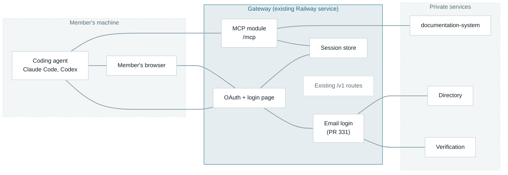

# Misty MCP Server Design (#335)

A walkthrough of how a coding agent signs a member in to Misty and reads the
documents that member is allowed to see.

**Interactive walkthrough:** [Misty MCP Sign-in Flow](https://claude.ai/artifact/J4dHpdMJRWAK4qYkSKxaMx)
steps through each flow below on the system map.

At a glance:

1. The member adds Misty to their coding agent with one command.
2. The agent calls a Misty tool. The gateway says "sign in first".
3. The agent opens the gateway's login page in the browser.
4. The member enters their email, then the code emailed to them (#331).
5. The gateway creates a session and gives the agent an access token and a
   refresh token.
6. The agent calls `search_documents` with the access token. The gateway
   works out which member it is and searches as them.
7. The agent calls `get_document` to read more of a document it found.
8. The agent writes the answer and cites the passages.

## The parts

| Part | What it does |
|---|---|
| **Coding agent** (Claude Code, Codex) | Opens the browser for sign-in, keeps the tokens, calls the tools, and writes the answer. |
| **Member's browser** | Shows the login page and carries a one-time code back to the agent. |
| **MCP module** (`/mcp`, inside the gateway) | Defines the tools, turns a token into a member, and trims results to a safe size. |
| **OAuth endpoints and login page** (inside the gateway) | Tells agents where to sign in, shows the email and code form, and hands out tokens. |
| **#331 email login** (inside the gateway, already built) | Checks that an email belongs to an active member and handles the one-time codes. |
| **Session store** (gateway database) | One row per sign-in. Records who signed in and stores token hashes. |
| **Existing `/v1` routes** (inside the gateway) | Unchanged. Other apps such as compute keep using them with `gw_` keys. |
| **documentation-system** | Holds the documents, ranks search results, and enforces who can see what. |
| **Directory** (team-tracking) | Knows who is an active member. |
| **Verification** | Sends and checks the one-time email codes. |

MCP is built into the existing gateway as its own module rather than as a new
service. The agent only ever talks to the gateway. The gateway talks to the
private services with its own keys.

## Overall workflow

1. **The whole system.** Nothing has happened yet. A member has added Misty to
   their coding agent with one command:
   - Claude Code: `claude mcp add --transport http misty https://<gateway-domain>/mcp`, then `/mcp`
   - Codex: `codex mcp add misty --url https://<gateway-domain>/mcp`, then `codex mcp login misty`

   No secrets go in the config. The only thing the agent knows is the `/mcp`
   address.

2. **Agent calls a tool with no token.** The member asks their agent a
   question, and the agent calls a Misty tool such as `search_documents`
   before it has signed in.

3. **Gateway asks for sign-in.** The gateway refuses with a `401`. The reply
   includes a link to a small public file that explains how to sign in.

4. **Agent finds the login server.** Nobody is signing in yet. The agent is
   only reading directions. The file from step 3 names the login server this
   MCP server trusts, which is the gateway itself. The agent then reads the
   login server's own file, which lists its addresses: where to send the member
   to sign in (`/authorize`) and where to collect tokens (`/token`).

   This step is why the agent only needs the `/mcp` address. Every MCP client
   looks these addresses up the same way, so Misty needs no setup that is
   specific to one client.

5. **Agent opens the login page.** The agent opens the member's browser on the
   gateway's login page. It also starts listening on a local port so the
   browser can hand something back once the member has signed in.

6. **Member enters their email.** The login page uses #331, the email login
   already built into the gateway. #331 checks that the email belongs to an
   active member in the directory, then asks verification to email them a
   one-time code. It limits how often codes can be requested and guessed. It
   shows the same "check your email" message whether or not the address
   belongs to a member, so the page can't be used to find out who is one.

7. **Member enters the code.** #331 checks the code. If it is right, the
   gateway creates a session: a database row recording who signed in (their
   `person_id`, the member's Misty ID) and in which environment
   (`misty:production`). The tokens the agent receives next point at this row.
   The gateway stores only a hash of each token, so a copy of the database
   can't be used to sign in. Deleting the row ends the session for all of its
   tokens at once.

8. **Login server sends the agent back.** The browser is sent to the agent's
   local listener with a short-lived, single-use code. This code is not a token
   yet.

9. **Agent swaps the code for tokens.** Tokens never travel through the browser,
   because anything in a browser address can leak through history or other
   apps on the machine. The agent sends the code straight to the gateway,
   together with a secret it created in step 5 (a PKCE verifier). That proves
   the agent finishing the login is the one that started it. The gateway then
   hands over two tokens:
   - an **access token** for tool calls, valid for about an hour;
   - a **refresh token** for getting new access tokens, valid for about 30 days.

10. **`search_documents`.** The agent repeats its original tool call, this time
    with the access token. The gateway looks up whose token it is and checks
    they are still an active member. It then searches documentation-system on
    behalf of that member, and gets back the best-matching passages from
    documents they are allowed to see. The agent receives each passage with
    its document's title, link, ID and citation.

11. **`get_document`.** The agent opens one document from the search results,
    using the document ID from step 10, and reads from just before the
    passage that matched. Long documents come back a page at a time, so the
    agent can keep reading where it left off. A document the member can't see
    looks the same as one that doesn't exist.

12. **The agent writes the answer.** Misty returns evidence. The coding agent's
    own model writes the answer and cites the passages, so Misty runs no model
    of its own for MCP. The access token never left the gateway.

## When the access token expires

1. After about an hour the access token stops working, and the next tool call
   gets a `401`.
2. The agent trades its refresh token for a new pair of tokens. The gateway
   checks that the session still exists and the person is still an active
   member, then retires the old refresh token. The member doesn't see a login
   page.
3. The agent repeats the call with the new access token and gets its results.

If an old refresh token is used again after a short grace period, the gateway
treats it as stolen and ends the whole session.

## When a session is revoked

1. The member logs out, or an admin revokes all of a person's sessions. Either
   way the session row is deleted.
2. The next tool call fails with a `401`, because the access token no longer
   matches a session. The gateway refuses it before touching any document.
3. Refreshing fails too, because the refresh token belonged to the deleted
   session. The agent has to sign in again.

Revoking stops future reads. It can't take back anything the agent already
received.

## When someone isn't a member

1. Anyone who adds Misty to their agent reaches the same login page.
2. If they enter an email that doesn't belong to an active member, #331 sends
   no code but shows the usual "check your email" message.
3. Without a code there is no session and no token, so every tool call keeps
   returning `401`.

Former members are caught too. Membership is checked again when the code is
confirmed, on every refresh, and on tool calls.

## Where each credential may travel

| Credential | Held by | Travels | Never |
|---|---|---|---|
| Access token | Coding agent | Agent ⇄ gateway `/mcp` | Sent on to any private service |
| Refresh token | Coding agent | Agent → `/token` and `/revoke` | Sent to `/mcp`, or stored unhashed |
| Authorization code | Browser, then agent | Gateway → browser → agent → `/token`, once | Reused, or accepted without the agent's secret |
| Email / login code | Member | Member's email → login page → #331 | Seen by the agent, or written to logs |
| `person_id` | Gateway | Session store → MCP module → documentation-system | Taken from the agent or its model |
| Internal `doc_` key | Gateway | Gateway → documentation-system | Seen by a coding agent |

The `doc_` key can read documents only on behalf of a named person (`docs:read`
and `act-as-user`). It must never have `docs:read:all`, which would let a
request with no person attached read everything. The agent never sends a
`person_id`; the gateway always takes it from the session.

## Tools

The first version is read-only. No tool accepts a person or identity, and tool
descriptions tell the agent that returned text is evidence, not instructions.

| Tool | What it does | Uses |
|---|---|---|
| `search_documents` | Finds the best-matching passages for a question | `POST /search` |
| `get_document` | Reads one document, a page at a time | `GET /docs/{id}` |
| `whoami` | Shows who is signed in and to which environment | The session |

What goes in and comes out:

- **`search_documents`** takes a question (`query`) and an optional number of
  results (`limit`, up to 10). It returns a list of results. Each one has the
  document's ID, title and link, the matching passage, and a citation saying
  where in the document the passage sits. A `truncated` flag says whether
  results were cut to fit the size limit.
- **`get_document`** takes a document ID (`doc_id`) and an optional place to
  start reading (`start_offset`). It returns the document's ID, title, link,
  when Misty last fetched it, and one page of its text. If there is more, it
  also returns `next_offset`, the place to start the next page.
- **`whoami`** takes nothing. It returns the signed-in member's email, the
  environment (such as `misty:production`), and when the session expires.

- Documents are opened by ID, not by title. Titles can be missing, repeated or
  renamed. To open a document by name, the agent searches for the title and
  uses the ID from the result.
- Search has no filters yet, because `/search` only accepts a query and a
  result count.
- The gateway returns only the fields listed above. In particular, a document's
  `grants` (who can see it) never reach the agent.
- Each result is capped at about 32 KiB, to stay under Claude Code's
  10,000-token warning.

What the agent sees when something goes wrong:

| Case | Response |
|---|---|
| No matches | Success with empty `results` |
| Document missing, or the member can't see it | The same `not_found` error |
| A service is down | `unavailable`, safe to retry |
| Too many requests | `rate_limited`, with how long to wait |
| Result too large | Success with `truncated: true` |
| Token expired or session revoked | HTTP `401`, which makes the agent refresh or sign in |

## Hosting and setup

| | Choice |
|---|---|
| Railway | The existing gateway service, no new service |
| Address | The gateway's domain, for example `https://<gateway-domain>/mcp` |
| Database | New session tables in the gateway's Neon project |
| Migrations | Added to the gateway's chain, after `002_email_login` from #331 |
| Replicas | One, the gateway's existing limit |
| Code owners | The existing `gateway` zone |

New gateway settings:

- `DOC_BASE_URL`: documentation-system's private Railway address.
- `DOC_API_KEY`: the internal `doc_` key, stored as `SecretStr` and checked at
  startup so a misconfigured deploy fails right away.
- An on/off switch, off by default like #331's login, so the code can merge
  before rollout.

The gateway also gains an MCP SDK dependency and new public routes: `/mcp`, the
login page, and the OAuth discovery, authorize, token and revoke endpoints.

### Why inside the gateway

| Alternative | Why not |
|---|---|
| A separate MCP service with its own domain | About the same code, plus another deployment, database and network hop. It would also need a `gw_` key that could act as any member, and every member would share that key's rate limit. |
| A private MCP service behind the gateway | The gateway would have to forward logins, OAuth and streaming, and requests would loop back through it. |
| A program each developer runs locally | We would have to ship it and build sign-in into it, and the gateway would still need per-member credentials. |
| MCP holding a documentation-system key directly, like the Discord bot | It would put a private service key on a public-facing service. |

## Limits and logging

### Login limits

MCP sign-ins use #331's limits unchanged. #331 normally files each login
under the name of the calling app's `gw_` key. MCP calls #331 inside the
gateway without a key, so its logins are filed under the fixed app name
`mcp` instead.

| Limit | Applies to | Amount |
|---|---|---|
| Per app | All MCP logins together, separate from compute's | 30 starts and 60 code checks a minute, 300 code emails an hour |
| Per IP address | Shared with every other app | 5 starts a minute and 20 an hour; 30 code checks a minute |
| Per mailbox | Shared with every other app | 1 code email a minute, 5 an hour, 20 a day |
| Per code | Each emailed code | 3 guesses, expires after 10 minutes |

- Heavy MCP use can't use up compute's login budget, because each app has its
  own.
- Switching between compute and MCP doesn't give anyone extra codes or
  guesses, because the IP and mailbox limits are shared.
- A login started through MCP can only be finished through MCP, because
  #331 ties each login to the app name that started it.
- The login page passes the member's real IP address to #331, taken from the
  same proxy header the gateway's existing IP limits already trust.

### Tool limits

These numbers are starting points to adjust after measuring.

- Each member gets about 30 tool calls a minute and 4 at a time. Search is
  limited more tightly, because every search makes a paid embedding call.
- Each tool call has about 20 seconds, and the call to documentation-system
  about 15.
- The gateway doesn't retry on its own. The agent decides, using the
  `unavailable` error.
- If the agent cancels a call, the gateway stops waiting for
  documentation-system. Work already started there may still finish.
- To rotate the internal key: create a new key under a new name, deploy it,
  then revoke the old one.

The audit log records who called which tool, the outcome, how long it took,
which client was used, how many results came back, and sign-in, refresh,
logout and revoke events. It never records tokens, keys, login codes, search
queries, passages or document text.

## Open questions

**Sign-off and dependencies**

- The gateway owner (@qiuethan) needs to agree to adding OAuth, login pages,
  sessions and an MCP SDK to the gateway.
- #331 is merged into `staging`. Confirm its login logic can be called directly
  from the MCP module. Mist #125, the compute side of #331, is still open.
- Choose an MCP SDK and version, and check it fits into the gateway's FastAPI
  app.

**Risks to measure**

- MCP bugs or heavy use could slow down the Discord resolver and compute login,
  which run in the same gateway.
- The gateway runs one copy, so slow searches could tie it up. Measure search
  speed under load.
- The gateway's limit of 120 requests a minute per IP address applies first, so
  developers on the same network share it.
- If the staging database is copied from production, it must not keep
  production's session rows.

**Gaps in existing services**

- During a directory outage, `GET /docs/{id}` can return `404`, so an outage
  can look like "document not found".
- Search results have a content hash but no fetch date, and documents have a
  fetch date but no hash, so out-of-date citations can't be reliably detected.
- It's not yet confirmed whether meeting notes show up in search.

**Client testing**

- Check that each client refreshes tokens reliably, using a 2-minute access
  token across several expiries with two windows open. A blog post from April
  2026 reports a Claude Code bug with addresses like `/mcp`.
- Decide how agents register with the login server. Claude Code and Codex
  support Client ID Metadata Documents; Cursor documents Dynamic Client
  Registration, which the spec now discourages.
- Check which spec version each client uses and how much output it accepts.
- Decide how to accept local callback addresses without accepting any address.
- VS Code support is not planned for the first version.

**Other decisions**

- Who maintains the MCP module alongside the gateway owner.
- Check real developer tasks against the three tools.
- How the OAuth issuer value matches #331's issuer value.
- Whether an off-the-shelf authorization server is worth comparing.

**Still to write**

- A test plan: real clients against fake services, covering sign-in, search
  and read, denied access, revocation, environment mismatch, large results,
  unavailable services and cancellation. Issue 6 below delivers it, but #335
  asks for the plan as part of the design.

## Implementation plan (epic)

Seven issues. 1 and 2 can start in parallel. Everything ships behind the
gateway's off switch until issue 7.

| # | Issue | Description | Deliverables | Depends on |
|---|---|---|---|---|
| 1 | **MCP foundation in the gateway** | • Pick an MCP SDK and pin its version • Mount `/mcp` in the gateway's FastAPI app as its own module • Add an on/off switch, off by default • Add a documentation-system client with its own timeouts | • `/mcp` answers `401` when on and `404` when off • `DOC_BASE_URL` and `DOC_API_KEY` (`SecretStr`) in `Settings`, `.env.example` and the startup check • Documentation client with fakes for tests • Note on how the SDK fits the gateway | — |
| 2 | **Session store** | • Add session tables: one row per sign-in, token hashes only • Rotate refresh tokens, with a short grace period before reuse ends the session • Revoke one session, or all of a person's sessions | • Migration `003` with a working downgrade • Storage Protocol implemented in both the in-memory and Postgres adapters • Shared adapter tests for expiry, rotation, reuse and revocation | — |
| 3 | **Sign-in: OAuth and login page** | • Discovery files for the MCP endpoint and the login server • `/authorize` with PKCE and safe local callback addresses • Login page that calls #331's email login inside the gateway • `/token` for codes and refreshes, and `/revoke` • Client registration (Client ID Metadata Documents) | • Working sign-in from `/authorize` to tokens, against fake directory and verification • Membership checked again on refresh • Issuer set per environment • Logins filed under the app name `mcp`, with the member's real IP passed to #331's limits | 2 |
| 4 | **Member binding and limits on `/mcp`** | • Turn the access token into a `person_id` on every call • Check the member is still active, with a short cache • Per-member limits on calls, concurrency and searches • Audit events without secrets or content | • Request dependency that gives tools only a checked `person_id` • Limits and `rate_limited` errors with a wait time • Audit log entries for tool calls and sign-in events, with tests that nothing private is logged | 1, 2 |
| 5 | **Tools: search, read, whoami** | • `search_documents`, `get_document` and `whoami`, all read-only • Return only allowed fields, cap size at about 32 KiB, page long documents • Map failures to `not_found`, `unavailable`, `rate_limited` and `401` • Tool descriptions say returned text is evidence, not instructions | • The three tools with their schemas and examples • Tests for denied access, empty results, large results, outages and cancellation • `grants` never returned | 1, 4 |
| 6 | **Client testing and evaluation** | • Run Claude Code and Codex against a fake-backed local stack • Test refresh with a 2-minute access token and two windows open • Try Cursor, and decide whether to support it | • Evaluation plan and results for every scenario #335 lists • Supported client and version list • Member setup guide with the install commands | 3, 5 |
| 7 | **Rollout** | • Create the `doc_` key with only `docs:read` and `act-as-user`, per environment • Make sure staging starts with empty session tables • Turn MCP on in staging, then production | • Deployment runbook, including key rotation and rollback • Staging check with a real sign-in • Production switched on after sign-off | 6 |

Not in this epic: the existing-service gaps listed under open questions
(outage `404`s, freshness data on search results, meeting notes in search).
Those belong to documentation-system and should be separate issues.

## Still to address

Things this version of the design doesn't settle yet:

- **Freshness on results.** Search results have no fetch date and documents
  have no content hash, so the agent can't tell whether a citation is out of
  date. Needs a documentation-system change.
- **Agreed workflows and clients.** Check the example workflows from #335
  against real developer tasks, confirm meeting notes are searchable.
- **Evaluation plan.** Write the real-client test plan, including what happens
  when a staging token is used against production.
- **Why only three tools.** Team and project context tools to be created in future versions.
- **Choosing an environment and getting updates.** Say which URL members use
  for staging and production, and that a hosted server updates without members
  installing anything.

## References

- [Issue #335](https://github.com/UTMIST/Misty/issues/335)
- [PR #331](https://github.com/UTMIST/Misty/pull/331)
- [Mist PR #125](https://github.com/UTMIST/Mist/pull/125)
- [MCP authorization, 2026-07-28](https://modelcontextprotocol.io/specification/2026-07-28/basic/authorization)
- [MCP security considerations](https://modelcontextprotocol.io/specification/2026-07-28/basic/authorization/security-considerations.md)
- [Claude Code MCP docs](https://code.claude.com/docs/en/mcp)
- [Codex MCP docs](https://learn.chatgpt.com/docs/extend/mcp?surface=cli)
- [Cursor MCP docs](https://cursor.com/docs/context/mcp)
