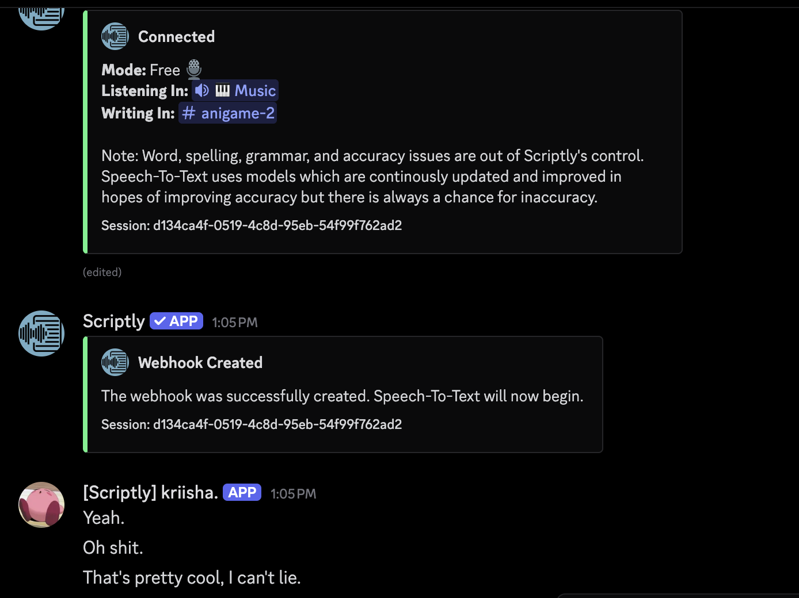
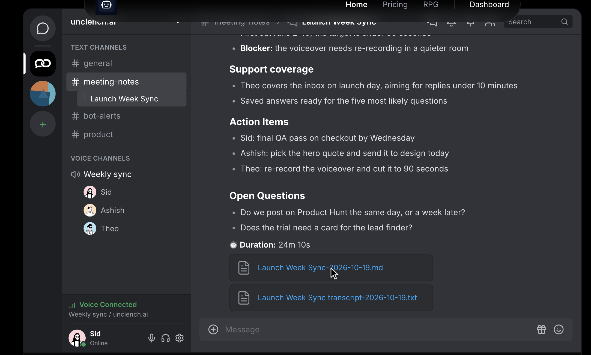

# Meeting access design

Related: [#285](https://github.com/UTMIST/Misty/issues/285)

## Problem

Currently, someone can join a private VC, run `/record start` in a public text
channel, and have the meeting PDF delivered there. Starting the recording from
that channel should not automatically expose the conversation to its members.

## Recording

```text
/record start
```

The caller must be in the VC being recorded and have a linked Misty account.
They can run the command from another channel. Both of these already work;
the change is where Misty sends the outputs. The new design excludes forum
channels and forum posts as trigger locations.

**CHANGE: By default, subtitles, the PDF, and the saved Google Doc link go to the
recorded VC's own chat.**

The channel where the command was typed receives only a private acknowledgement.


```text
/record start [output_channel:<channel>]
```

### Potential addition

If we really don't like the inflexibility of the above, we can allow admins that trigger `/record` and change the output channel of the transcription (in discord).

`output_channel` lets an admin deliberately choose another
Discord audience for the transcript. This can be in the form of a `text` channel, a `vc text channel`. Admin-only use is the intended direction;
we still need to choose which admin permission authorizes it.

If Misty loses the required permission to post during recording, it stops the
recording. It must not automatically send the content to another channel.

## Forum triggers

Meeting features must not be triggered from forum channels or forum posts.
Supporting those trigger locations adds complexity, so they are excluded from
this design.

## Subtitles — separate discussion

Discord does not support threads inside VC chat. We need a separate discussion
on how to present subtitles within the chosen output destination.

### Current solution (though not preferred)

Posting batched messages directly in chat is an option, not a settled decision.
However, using the initial **thread** solution causes many challenges. For example..
- If we restrict `\record` to be called within a VC chat, we cannot use threads
- If we completely abandon the **VC \record only** solution and use **threads for subtitles**, the following issues arise. (1) During a pending call, we remove/add users. We also need to remove/add them from the thread permission.

### Additional notes to live subtitles

Currently, Discord does not have a native solution for live subtitiles. It's an ongoing accessibility issue. There are some discord bots that do live transcription though, but using the similar **post message in channel** method we have. Some examples..

[Scriptly](https://www.scriptly.xyz/)


[Discmeet ai slop](https://discmeet.com/)


The second one is frankly more interesting as you configure a meeting notes channel, and it adds threads to it.

However, this brings forth the same privacy issue with private/public/locked VCs.
See [What if we really want the thread solution?](#what-if-we-really-want-the-thread-solution)
for the most controlled approach we could support and its limitations.

## Q&A

`/qna` runs **only in the recorded VC's chat**, even if an admin selected a
different output channel for the transcript.

Anyone who can read and write in that chat and use the command can ask about
the active meeting. They do not need to be connected to voice. Answers are
private to the person asking.

Misty checks that access before generating an answer and again before sending
it. Being allowed to read the alternate output channel does not grant Q&A
access. The existing live-transcript window still applies.

## Who can see the content?

Discord controls access to the subtitles and PDF through the selected channel's
permissions. This is not a fixed list of attendees: someone granted access
later may read the history (depending on how the channel is configured). Removing access cannot undo a download or copy.

Saved Google Docs use a separate, existing rule: **the teams configured for the
recorded VC receive access through their Google Groups.** They can read and
comment. Joining the call or receiving the link does not grant Google access.
Without configured teams, or if their groups are not synced, the Doc is saved
for infrastructure/Drive admins only.

Changing `output_channel` does not change Google sharing. A PDF posted in
Discord is a separate copy and is not protected by the Doc's Google permissions.
The full saved-record policy is in
[MEETING-RECORDING.md](MEETING-RECORDING.md#google-setup).

## Separate document access from transcript sharing

`/channel-access` currently stores one channel-to-team mapping that is used for
two different purposes:

| Use | What configuring Team A means |
| --- | --- |
| Document answers | Misty may use Team A's documents when answering in this channel. |
| Saved meeting sharing | Meetings recorded in this VC are shared with Team A through its Google Group. |

The second use is implemented in the saved-meeting code, but the command's
description only explains the first. An admin choosing which documents Misty
can reference may not realize they are also choosing who receives future
meeting transcripts.

### Possible separate transcript-sharing command

We may want a dedicated command for saved transcript/meeting Doc sharing,
leaving `/channel-access` responsible only for document-answer scope. For
example, a separate `/meeting-sharing` command could configure the VC's sharing
teams. The name and interface are still to be decided.

Under that separation, changing document-answer scope would not change future
meeting sharing, and changing meeting sharing would not expand which documents
Misty can use in answers. Discord visibility would still follow the selected
output channel's permissions; the new command would govern Google Doc sharing.

This revisits the earlier decision to use `/channel-access` for meeting-team
configuration. Team-based saved Doc access itself remains agreed. If we choose
to split the settings, we must decide how existing VC mappings carry over and
what happens when no transcript-sharing teams are configured.

## Still to decide

- **Which admins can select `output_channel`?** Misty admins, Discord admins,
  or another permission? Is their explicit selection enough to approve sharing?
- **Which destinations can they select?** Start with ordinary text channels,
  or also support threads and forum posts?
- **What happens if output is unavailable?** Define startup failures and safe
  final delivery after posting permission is lost. Never fall back publicly.
- **What if permissions broaden mid-meeting?** Continue with the new audience,
  or stop recording?
- **Keep saved Docs team-scoped?** This includes team members who missed the
  meeting and future members of the same Google Group.
- **How do admins configure a VC's teams?** Verify `/channel-access` in VC chat;
  consider adding an explicit `channel:` option so it can be configured elsewhere.
- **Where do notices go with an override?** Decide where to announce recording
  and show meeting status without exposing details in unrelated channels.

## Question and answer matrix

Answers agreed so far are recorded here; unanswered items remain open. This
matrix takes precedence where a decision revises the earlier discussion above.

| Question | Answer | Status |
| --- | --- | --- |
| Which admins can select `output_channel`? | Misty admins. Their explicit selection approves the destination; no separate VC-to-channel mapping is required. | Decided |
| Which destinations can they select? | Ordinary text channels and VC chats. No forums, forum posts, or threads in the initial selector. | Decided |
| What permissions are required before starting? | Both message-sending and PDF attachment permissions, with access to the selected destination. Refuse to start if either is missing; no link-only fallback. | Decided |
| What if required output permissions are lost mid-recording? | Continue recording; permission loss may be accidental or temporary. Do not automatically send content to another channel. | Decided |
| When should a permission-related delivery error appear? | When recording ends automatically or `/record stop` is called, attempt delivery to the original selected destination. If permissions were restored, deliver normally; otherwise report the delivery failure where possible. | Decided |
| How is failed final delivery recovered? | Retry/recovery policy still needs to be defined; recording does not stop early because output permissions changed. | Open |
| What if permissions broaden mid-meeting? | Continue recording. Current Discord permissions govern visibility. | Decided |
| Keep saved Docs team-scoped? | Yes. Retain the recorded VC's configured-team sharing, including team members who missed the call and future members of those teams. Discord output access remains separate. | Decided |
| How do admins configure a VC's teams? | Keep current `/channel-access` behavior: configure the invocation channel (the parent for threads). Configure a VC from its own chat; do not add a `channel:` selector. Live VC-chat availability still needs verification. | Decided |
| Should transcript sharing have its own command? | Consider separating saved meeting Doc sharing from `/channel-access` document-answer scope; see the dedicated section above. This revisits which command owns meeting-team configuration. | Open |
| Where do notices go with an override? | Not yet decided. | Open |

## What if we really want the thread solution?

We could create **one private subtitle thread per meeting in an admin-configured
ordinary text channel**. The recording can still start from elsewhere; the
thread's parent channel is a separate destination. This does not require forum
triggers or move `/qna` out of VC chat.

The most controlled version we could support would:

- Invite only the selected meeting audience. First decide whether that means
  call participants or people authorized to access the VC; a voice "lock"
  alone does not define that audience. Invitees must also be able to view the
  parent text channel.
- Let Misty manage membership and disable ordinary members' ability to invite
  others. Reconcile additions/removals during the meeting; if access cannot be
  maintained, stop publishing subtitles rather than switch to a public thread.
- Optionally stop automatic additions when recording ends, as discussed
  earlier. Decide separately whether later access removals must keep syncing.
- Keep the transcript in that thread after the meeting. Archiving or locking
  it is housekeeping, not deletion or access revocation.

**Limits:** authorized moderators can still access private threads, newly added
members may read earlier subtitles, and membership updates are not an atomic
extension of VC permission changes. We cannot revoke content already copied.
A public thread is suitable only when its entire parent-channel audience is
approved to read the meeting.

This buys a separate conversation per meeting, at the cost of a second audience
that Misty must maintain. These are options to discuss, not selected requirements.
See [Discord's thread permissions](https://docs.discord.com/developers/topics/threads)
and [private-thread invite controls](https://docs.discord.com/developers/resources/channel#thread-metadata-object).
