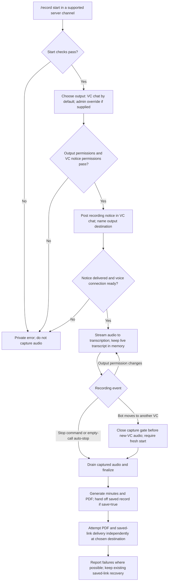
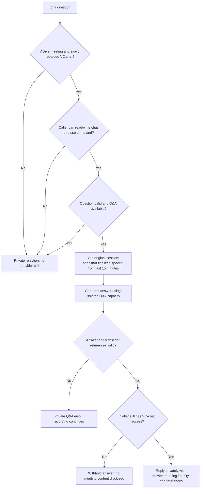

# Meeting access design

Related: [#285](https://github.com/UTMIST/Misty/issues/285)

## Transcription and delivery flow

These diagrams describe the intended design, including the decisions in the
answer matrix. Error labels below are documentation references, not new API
error codes.



Start checks cover a linked account, caller presence in the recorded VC, no
other active recording in the server, supported trigger location, and Misty
admin authority for an override. All checkable authorization and permission
failures must be rejected before paid processing or audio capture. The bot must
successfully post the notice before capture begins; a failed join must not be
reported as an active recording.

Audio is not persisted. A saved Google Doc uses the VC's team sharing, not the
Discord output channel's audience. `save:false` skips Google persistence and
link delivery. Output permission loss does not stop capture; recheck at final
delivery. Audience expansion also does not stop recording. A VC move closes
capture before destination-channel audio can enter either recording mode.

## Live Q&A flow



Voice presence is not required for Q&A. An output override does not move Q&A
or grant access to it. Bind an accepted question to its original session so a
later recording cannot become its source. Q&A failures must not interrupt audio
ingestion or meeting finalization. Questions outside the available transcript
must receive an insufficient-evidence answer rather than invented facts.

The implemented Q&A window is the last **15 minutes of elapsed meeting time**,
including silence, or the meeting so far if shorter. Only speech finalized at
request time is available. Dense transcripts can shorten the window further;
the response discloses the retained range. See the existing
[Q&A API contract](../services/meeting/docs/API.md#post-meetingssession_idqna).

## Common errors and handling

Messages below describe the intended user-facing response; exact wording can
follow the bot's existing messages. Errors and acknowledgements are private
where an interaction is available. For automatic stops or inaccessible channels,
report where possible without sending meeting content to a different audience.
Do not log questions, transcripts, answers, or credentials.

### Recording and output

| Case | Required flow | Error or notice |
| --- | --- | --- |
| Unlinked caller or directory unavailable | Refuse before starting; do not guess identity. | "Link your account first" or "I cannot verify you right now; try again shortly." |
| Caller is not in voice | Refuse before starting. | "Join a voice channel first." |
| Recording already active in the server | Keep the existing meeting; do not start another. If the caller cannot view the recorded VC, or access cannot be verified, give only a generic private error without the VC name/reference, elapsed time, meeting title, requester, or Doc link. | "A recording is already active in this server." |
| Forum trigger, unsupported output type, or unauthorized override | Reject before capture/provider calls; do not silently ignore the option. | "Meeting commands are not supported in forums," "Choose a text channel or VC chat," or "Only Misty admins can select an output channel." |
| Required output permission missing at startup | Refuse; identify view/send/attachment permission, plus history access for saved recordings. | "Cannot start: I need [permission] in the selected output channel." |
| VC-chat notice permission missing, or notice send fails | Refuse even if the output override is writable; do not capture without the notice. | "Cannot start: I could not post the recording notice in VC chat." |
| Bot cannot join voice or recording service is unavailable | Abort startup and release partial session resources. | "Could not join the voice channel" or "Meeting recording is unavailable." |
| Status or stop requested by a caller who cannot view the recorded VC, or whose access cannot be verified | Give only a generic private response. Do not reveal the VC name/reference, elapsed time, meeting title, requester, or Doc link. Preserve existing stop authorization, including the empty-VC exception; any permitted stop gets a generic acknowledgement and output stays at the selected destination. | "No recording details are available to you here," or a generic acknowledgement if the stop is permitted. |
| Stop requested outside the recorded VC while it still has people, and the caller can view that VC | Leave recording active; retain the existing empty-VC stop exception. | "Join the recorded voice channel to stop this recording." |
| Output permissions lost or audience broadened mid-meeting | Continue recording. Attempt delivery at end; never redirect automatically. | No interruption solely for this change; report any remaining delivery failure when recording ends. |
| Bot moves to another VC | Stop capture before new-VC audio enters, then finalize the original meeting, including `save:false`. | "Recording ended because I moved voice channels. Start a new recording in the new channel." |
| Voice/stream connection drops | Use existing best-effort finalization/recovery; do not promise a complete transcript or restart a new session silently. | "Connection lost; wrapping up the captured recording," or "The recording could not be recovered" if recovery fails. |
| Finalization, PDF generation, or upload fails | Report failure where possible. Do not add durable PDF retries or suppress independently available saved-link delivery. | "Could not generate/deliver the meeting PDF." Distinguish generation from upload failure. |
| Saved Doc is pending, failed, or admin-only | Do not announce a pending/failed save as a saved link. Retain existing persistence handling; explain admin-only sharing separately. | "The meeting record is still saving," "The meeting record could not be saved," or "The saved record is admin-only." |
| Saved-link post fails, destination is deleted, or required permissions remain missing at end | Retain the original selected destination and existing link retry/restart recovery; do not reroute. | "Could not deliver the saved meeting link; restore access to the original destination for retry." |
| Bot or meeting service restarts during a live meeting | Do not promise recovery of in-memory session state. Recover already-persisted pending link deliveries separately. | "No active recording" or a recovery-failure notice where possible; do not claim recording continued. |

A failure in one output must not prevent attempting another independently
available output. Saved-link retry success does not imply that a failed PDF was
retried or delivered. If the notice cannot be sent, a log/status failure can be
recorded without copying meeting content into an unrelated channel or DM.

### Q&A

HTTP statuses here are the existing meeting-service Q&A responses; local
Discord access rejections do not need to become new service HTTP errors.

| Case | Required flow | Private response / service status |
| --- | --- | --- |
| No active recording | Do not invoke Q&A. | "No active meeting in this server." An expired backend session returns `404`. |
| Wrong channel, forum, DM, or missing VC-chat read/write/command access | Reject before provider use; do not expose a private VC's identity to an unauthorized caller. | "Use Q&A in the recorded VC chat with the required access." |
| Blank question or more than 1,000 characters | Reject before provider use. | "Enter a question containing text, up to 1,000 characters." Backend validation: `422`. |
| Meeting starts stopping before Q&A is admitted | Do not switch to another session or retry against a new meeting. | "This recording is ending or has ended." `409`. |
| Q&A capacity is full | Reject the question without blocking transcription or stop. | "Meeting Q&A is busy; try again shortly." `429`. |
| Latest transcript segment cannot fit | Do not send an oversized request to the model. | "The latest transcript passage is too large; try again after more speech is transcribed." `413`. |
| Little transcript or no supporting evidence | Answer only from available evidence; disclose a shortened window when used. | "There is not enough information in the available transcript to answer that." Not a transport error. |
| Invalid answer or unverifiable references | Do not publish the invalid answer. | "I could not generate a reliable answer; try again." `502`. |
| Provider timeout | Release the request path without disrupting capture; retain existing worker-capacity safeguards. | "The answer took too long; try again shortly." `504`. |
| Q&A unconfigured, unavailable, or provider/network failure | Fail this question only; do not expose internal credentials/provider details. | "Meeting Q&A is not configured" or "temporarily unavailable." Backend availability failure: `503`. |
| Caller loses access before answer delivery | Recheck and withhold meeting content; do not deliver it elsewhere. | Generic permission failure if a private response is still possible. |

Existing error mappings:
[Q&A adapter](../discord-bot/src/adapters/discord/qna.js),
[meeting API](../services/meeting/src/api/routers/meetings.py), and
[saved-link recovery](../discord-bot/docs/meeting-delivery.md).

## Problem

Currently, someone can join a private VC, run `/record start` in a public text
channel, and have the meeting PDF delivered there. Starting the recording from
that channel should not automatically expose the conversation to its members.

## Recording

```text
/record start
```

The caller must be in the VC being recorded and have a linked Misty account.
They can run the command from another channel.

Both of these already work; the change is where Misty sends the outputs.

The new design excludes forum channels and forum posts as trigger locations.

**CHANGE: By default, the PDF and the saved Google Doc link go to the recorded VC's own chat.**

The channel where the command was typed receives only a private acknowledgement.

### Admin-only command


```text
/record start [output_channel:<channel>]
```


If we really don't like the inflexibility of the above, we can allow admins that trigger `/record` and change the output channel of the transcription (in discord).

`output_channel` lets an admin deliberately choose another Discord audience for the transcript. This can be in the form of a `text` channel, a `vc text channel`. Admin-only use is the intended direction.

If Misty loses the required permission to post during recording, it continues
recording. When the meeting ends or `/record stop` is called, attempt delivery
to the selected output channel. If permissions are still missing, report the
delivery failure where possible and retain existing saved-link recovery.
It must not automatically send the content to another channel.

## Forum triggers

Meeting features must not be triggered from forum channels or forum posts. Supporting those trigger locations adds complexity, so they are excluded from this design.

## Q&A

`/qna` runs **only in the recorded VC's chat**, even if an admin selected a
different output channel for the transcript.

Anyone who can read and write in that chat and use the command can ask about
the active meeting. They do not need to be connected to voice. Answers are
private to the person asking.

Misty checks that access before generating an answer and again before sending
it. Being allowed to read the alternate output channel does not grant Q&A
access. Q&A already uses the last **15 minutes of elapsed meeting time**, or the
meeting so far if shorter, with only finalized speech available at request time.
Dense transcripts may shorten that window further and disclose the retained
range, as defined in the existing
[Q&A API contract](../services/meeting/docs/API.md#post-meetingssession_idqna).

## Who can see the content?

Discord controls access to the PDF through the selected channel's permissions. This is not a fixed list of attendees: someone granted access
later may read the history (depending on how the channel is configured). Removing access cannot undo a download or copy.

Saved Google Docs use a separate, existing rule: **the teams configured for the
recorded VC receive access through their Google Groups.** They can read and
comment. Joining the call or receiving the link does not grant Google access.
Without configured teams, or if their groups are not synced, the Doc is saved
for infrastructure/Drive admins only.

Changing `output_channel` does not change Google sharing. A PDF posted in
Discord is a separate copy and is not protected by the Doc's Google permissions.
The full saved-record policy is in
[MEETING-RECORDING.md](MEETING-RECORDING.md#google-setup).

## Separate document access from transcript sharing

`/channel-access` currently stores one channel-to-team mapping that is used for
two different purposes:

| Use | What configuring Team A means |
| --- | --- |
| Document answers | Misty may use Team A's documents when answering in this channel. |
| Saved meeting sharing | Meetings recorded in this VC are shared with Team A through its Google Group. |

The second use is implemented in the saved-meeting code, but the command's
description only explains the first. An admin choosing which documents Misty
can reference may not realize they are also choosing who receives future
meeting transcripts.

### Possible separate transcript-sharing command

We may want a dedicated command for saved transcript/meeting Doc sharing,
leaving `/channel-access` responsible only for document-answer scope. For
example, a separate `/meeting-sharing` command could configure the VC's sharing
teams. The name and interface are still to be decided.

Under that separation, changing document-answer scope would not change future
meeting sharing, and changing meeting sharing would not expand which documents
Misty can use in answers. Discord visibility would still follow the selected
output channel's permissions; the new command would govern Google Doc sharing.

This revisits the earlier decision to use `/channel-access` for meeting-team
configuration. Team-based saved Doc access itself remains agreed. If we choose
to split the settings, we must decide how existing VC mappings carry over and
what happens when no transcript-sharing teams are configured.


## Question and answer matrix


| Question | Answer | Status |
| --- | --- | --- |
| Which admins can select `output_channel`? | Misty admins and superusers. Their explicit selection approves the destination; no separate VC-to-channel mapping is required. | Decided |
| Which destinations can they select? | Ordinary text channels and VC chats. No forums, forum posts, or threads in the initial selector. | Decided |
| What permissions are required before starting? | Require access to the selected destination, message-sending permission, and PDF attachment permission. Saved recordings also require `ReadMessageHistory` there because saved-Doc link delivery checks history before sending. Independently verify Misty can view and send messages in the recorded VC's chat, even with an output override, so the recording notice can be posted before capturing audio. Refuse to start if a required permission is missing; no link-only fallback. | Decided |
| What if Misty moves to another VC during recording? | Stop forwarding audio before any audio from the new VC enters the session, then finalize the original meeting. This applies to saved and PDF-only (`save:false`) recordings. Keep the original output destination; recording the new VC requires a fresh start. | Decided |
| What if required output permissions are lost mid-recording? | Continue recording; permission loss may be accidental or temporary. Do not automatically send content to another channel. | Decided |
| When should a permission-related delivery error appear? | When recording ends automatically or `/record stop` is called, attempt delivery to the original selected destination. If permissions were restored, deliver normally; otherwise report the delivery failure where possible. | Decided |
| How is failed final delivery recovered? | Keep existing behavior: saved-Doc link delivery retries at the original selected destination through the existing recovery process, including after restart. Report PDF upload failures where possible; do not add a durable PDF retry system in this change or redirect output automatically. | Decided |
| Which channel is stored for saved-link recovery? | Persist the selected output destination in `text_channel_id`: the recorded VC's chat by default, or the admin's override. Keep `voice_channel_id` separate for Google Doc sharing. Immediate delivery and restart recovery must use the stored output destination, not the launch channel, for the meeting title, start time, requester mention, and Doc link. | Decided |
| What may duplicate-start, status, or stop replies reveal to callers without VC visibility? | Only a generic private response: no VC name/reference, elapsed time, meeting title, requester, or Doc link. Apply this to "recording already active" errors as well as status/stop replies, and treat unverifiable access the same way. Preserve existing stop authorization and the empty-VC exception; any permitted stop gets a generic acknowledgement, not meeting details or redirected output. | Decided |
| Which transcript window does Q&A use? | Keep the implemented last-15-minutes window, measured in elapsed meeting time including silence; use the meeting so far if shorter. Only finalized speech at request time is included. Dense transcripts may shorten the window further, with the retained range disclosed. | Existing behavior |
| What if permissions broaden mid-meeting? | Continue recording. Current Discord permissions govern visibility. | Decided |
| Keep saved Docs team-scoped? | Yes. Retain the recorded VC's configured-team sharing, including team members who missed the call and future members of those teams. Discord output access remains separate. | Decided |
| How do admins configure a VC's teams? | Keep current `/channel-access` behavior: configure the invocation channel (the parent for threads). Configure a VC from its own chat; do not add a `channel:` selector. Live VC-chat availability still needs verification. | Decided |
| Should transcript sharing have its own command? | Consider separating saved meeting Doc sharing from `/channel-access` document-answer scope; see the dedicated section above. This revisits which command owns meeting-team configuration. | Open |
| Where do notices go with an override? | Post the recording-start notice in the recorded VC's chat, explicitly naming the selected output channel. Check VC-chat access and message-sending permission beforehand and deliver the notice before capturing audio; do not start if it cannot be posted. Command acknowledgements stay private; the PDF and saved-Doc link go to the selected output destination. | Decided |

## Offline acceptance cases to test

- **Duplicate start, status, and stop without VC visibility:** while another
  recording is active, invoke `/record start`, `/record status`, and
  `/record stop` from an unrelated accessible channel as someone unable to view
  the recorded VC. For the duplicate start, place the caller in a different VC
  and verify the original meeting continues without starting another. Verify
  private replies contain no VC name/reference, elapsed time, title, requester,
  or Doc link. Cover a denied stop while people remain,
  a stop allowed by the existing empty-VC exception, a stop failure, and an
  unresolved permission lookup. Keep final output at its selected destination.
- **Saved-link destination survives restart:** start from `#general` while in a
  private VC, finalize the recording, and restart before saved-link delivery
  succeeds. Verify `text_channel_id` stores the VC's ID and recovery posts the
  meeting title, start time, requester mention, and Doc link only in VC chat.
  Repeat with an admin-selected output channel and verify only that destination
  receives the recovered link message. `#general` must receive no public meeting
  details in either case; `voice_channel_id` remains the recorded VC's ID.
- **PDF-only recording moves from team A's VC to team B's VC:** start with
  `save:false`, capture A's speech, and simulate the move while B's audio begins
  arriving. Verify the capture gate closes before B's audio is forwarded,
  A's PDF contains only A's audio-derived content, and no new recording starts
  automatically. A fresh `/record start` is required for B's VC.
- **Saved recording lacks history access:** allow viewing, sending messages,
  and attaching files at the selected destination, but deny
  `ReadMessageHistory`. Verify startup is refused before capturing audio or
  invoking paid providers, with an error identifying the missing permission.
  Allowing PDF delivery alone must not bypass the saved-link prerequisite.

## Subtitles — TBD

Subtitles are deferred. Placement, presentation, access handling, and error
behavior remain TBD; they are not part of the recording and Q&A flow above.
The notes below preserve the options discussed, not selected requirements.
An earlier idea was to use the same output destination as the PDF and saved
link, but subtitle routing is also TBD.

Discord does not support threads inside VC chat.

### Option: batched messages

Posting batched mestsages directly in chat is an option, not a settled decision.
However, using the initial **thread** solution causes many challenges. For example..
- If we restrict `\record` to be called within a VC chat, we cannot use threads
- If we completely abandon the **VC \record only** solution and use **threads for subtitles**, the following issues arise. (1) During a pending call, we remove/add users. We also need to remove/add them from the thread permission.

### Subtitle examples

Currently, Discord does not have a native solution for live subtitiles. It's an ongoing accessibility issue. There are some discord bots that do live transcription though, but using the similar **post message in channel** method we have. Some examples include Scriptly and Discmeet.

The second one (Discmeet) is frankly more interesting as you configure a meeting notes channel, and it adds threads to it.

However, this brings forth the same privacy issue with private/public/locked VCs.
See [What if we really want the thread solution?](#what-if-we-really-want-the-thread-solution)
for the most controlled approach we could support and its limitations.

### What if we really want the thread solution?

We could create **one private subtitle thread per meeting in an admin-configured
ordinary text channel**. The recording can still start from elsewhere; the
thread's parent channel is a separate destination. This does not require forum
triggers or move `/qna` out of VC chat.

The most controlled version we could support would:

- Invite only the selected meeting audience. First decide whether that means
  call participants or people authorized to access the VC; a voice "lock"
  alone does not define that audience. Invitees must also be able to view the
  parent text channel.
- Let Misty manage membership and disable ordinary members' ability to invite
  others. Reconcile additions/removals during the meeting; if access cannot be
  maintained, stop publishing subtitles rather than switch to a public thread.
- Optionally stop automatic additions when recording ends, as discussed
  earlier. Decide separately whether later access removals must keep syncing.
- Keep the transcript in that thread after the meeting. Archiving or locking
  it is housekeeping, not deletion or access revocation.

**Limits:** authorized moderators can still access private threads, newly added
members may read earlier subtitles, and membership updates are not an atomic
extension of VC permission changes. We cannot revoke content already copied.
A public thread is suitable only when its entire parent-channel audience is
approved to read the meeting.

This buys a separate conversation per meeting, at the cost of a second audience
that Misty must maintain. These are options to discuss, not selected requirements.
See [Discord's thread permissions](https://docs.discord.com/developers/topics/threads)
and [private-thread invite controls](https://docs.discord.com/developers/resources/channel#thread-metadata-object).
