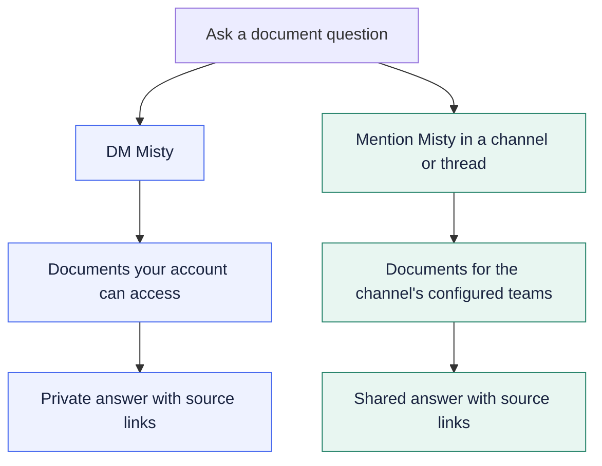

# Documents

Use Misty to find a team document, save a useful link in the catalog, or
make a Google folder available for automatic discovery. You need a
[linked account](Getting-started.md) to use the document commands.

## How a file reaches Misty

The original file stays with its source, such as Google Drive. Misty's
catalog keeps its title and link, along with the information needed to
decide who can find it. For supported readable files, Misty also processes
the text into a searchable copy that can support answers in chat.

This happens after you add a link or Misty discovers a shared Google file.
For Google files, periodic refresh picks up later source edits and access changes, so a
successful edit in Google does not mean Misty's copy has already updated.
Open the original link when you need to check the latest wording.

To share through your team, start with
[how team Google access works](Teams.md#use-your-teams-google-files).
Admins setting up a folder for everyone should follow
[Share team documents](Managing-access-and-documents.md#share-team-documents).

## Find a document

1. In Discord, choose `/doc search`.
2. In the `query` field, enter a few words describing what you need, such as
   `robotics onboarding`.
3. Send the command and read Misty's results.
4. Open the title or link of the document you want.

Your command will look like this:

```text
/doc search query:robotics onboarding
```

The results are visible only to you. Misty searches the documents available
to your account and returns matching titles and links. You still need your
own permission to open the original file.

For example, a search might return the following fictional documents. The
real reply includes each document's URL:

> **Misty — sample private search results**
>
> 1. **Robotics onboarding guide** · gdocs — document link
> 2. **New member checklist** · gdocs — document link

If you get no results, try a more specific topic or a different term from
the document. If you know the file exists, follow
[the missing-document checks](Help-and-troubleshooting.md#i-cannot-find-a-document).

To get an explanation from the contents rather than a list of links,
[ask Misty about the document](Talking-to-Misty.md#ask-about-documents).

### Choose where to ask a document question



Both paths require document answers to be enabled. A shared link does not
grant Google access, and threads use their parent channel's team settings.

## Browse your team's documents

Use `/doc list` when you want to see what is in the catalog without starting
with a search term.

1. Choose a channel where it is appropriate to share the document titles
   and links. **The `/doc list` reply is visible in that channel.**
2. Select `/doc list` and use the `team` option to choose your team.
3. Send the command and open a link from the list.

For example, `/doc list team:robotics` lists matching robotics documents.
You can narrow the list further using a `tag`, such as `onboarding`, or a
`source`, such as `gdocs` for Google Docs:

```text
/doc list team:robotics tag:onboarding
/doc list source:gdocs
```

For private results, use `/doc search`, or ask Misty for a private document
list through chat when actions are enabled.

## Add a document or link

Add useful links so you and your team can find them again through Misty.

1. Copy the document's URL.
2. Choose `/doc add` and paste it into the `url` field.
3. If it belongs to a team, select that team in the `team` option.
4. Optionally add a readable `title` and comma-separated `tags`, such as
   `onboarding,robotics`.
5. Send the command and check Misty's confirmation.

If you omit the title, Misty tries to fetch one. If the link is already in
the catalog, Misty tells you and can merge the tags you supplied.

Choose the team carefully because it affects who can find the catalog
entry. Adding a URL does not change access to the original file on Google
Drive, GitHub or another site.

Read any warnings in the reply. A link may be saved successfully even when
Misty cannot read or search its contents yet. For content search, the source
must be supported and readable by Misty, and its text must have finished
processing.

<details>
<summary>Example: save an onboarding guide with tags</summary>

Choose `/doc add` and fill in these options. Replace the placeholder with
your real document URL.

| Field | Example value |
|---|---|
| `url` | Your onboarding guide's URL |
| `title` | Robotics onboarding guide |
| `team` | robotics |
| `tags` | onboarding,robotics |

After Misty confirms the entry was catalogued, use
`/doc list team:robotics tag:onboarding` in a suitable channel to find it
again. This verifies the catalog entry; content search may still need time
or attention to the warnings from `/doc add`.

</details>

## Add GitHub and web documents

You can use `/doc add` for a GitHub repository, a specific text file, or a
public web page as well as a Google file.

| Link you add | What Misty can read |
|---|---|
| A GitHub repository URL | Its README. |
| A GitHub file URL containing `/blob/` | That one UTF-8 text file, such as a Markdown guide. |
| A readable public web page | Text extracted from the page. |
| A source without a text reader, such as YouTube | A catalog link; the video itself is not transcribed or searchable. |

For example, `/doc add url:https://github.com/UTMIST/Misty` catalogues the
repository and attempts to read its README. To ask about another guide in
that repository, open the file on GitHub and add its file URL too. Misty
does not crawl the whole repository, its issues, pull requests or wiki.

Private repositories need access configured by the Misty operator. Your
own GitHub access does not automatically give Misty access. Check the
command's warnings and choose the catalog audience carefully; people still
need their own permission to open the original GitHub link.

GitHub and web files are added explicitly. The automatic discovery and
scheduled source refresh described here apply to Google files. If an
imported GitHub or web document becomes stale, ask an operator to refetch it;
adding the same non-Google URL again does not refresh its text.

## Share Google files for automatic discovery

For a collection of team documents, you can share a My Drive folder with
Misty so it can find supported files inside it, including files added later.
Ask a Misty admin whether automatic discovery is enabled and for the exact
Google email address to share with.

1. In Google Drive, open the sharing settings for the intended file or
   My Drive folder.
2. Add the Google account provided by your Misty admin. The current setup
   needs **Editor** sharing to read the full list of who has access.
   Misty's reader does not edit your files or change their sharing.
3. Make sure the intended people also have access, either through their
   own Google email or through the team Google Group supplied by your admin.
4. If your Google email differs from the one on your Misty profile,
   [add and verify that email](Getting-started.md#add-another-email).
5. Allow time for Misty to discover and process the files, then check with
   `/doc search`.

You do not need to run `/doc add` for each supported file in the shared
folder. Nested folders and later additions are included. Misty checks
periodically, so a large folder can take more than one run to appear.
Later edits and permission changes are also picked up periodically.

For example, suppose your shared **Robotics** folder contains an onboarding
Doc and a **Meetings** subfolder. Misty can discover supported files in both.
If you later add a planning Doc inside **Meetings**, a later scan can pick
it up without another `/doc add` command.

Supported files include Google Docs, Sheets, Slides, Forms edit files,
PDFs, Word `.docx` files, and text files. This discovery flow covers My Drive
files and folders; it does not follow shortcuts or scan Shared Drives.

Sharing with Misty does not make a file visible to everyone. An “anyone with
the link” or domain-wide share alone does not tell Misty which members should
be able to find it. If a shared file stays missing, ask an admin to check it
instead of broadening its sharing.

## Remove an entry

Send a Misty admin the document link and ask them to remove it from the
catalog. They can use `/doc remove` to retire the entry. This leaves the
original source file in place.

To remove the stored contents of a meeting, follow
[Request removal](Meetings.md#request-removal). Include the meeting ID or
Google Doc link so the admin can locate the saved transcript and minutes.
