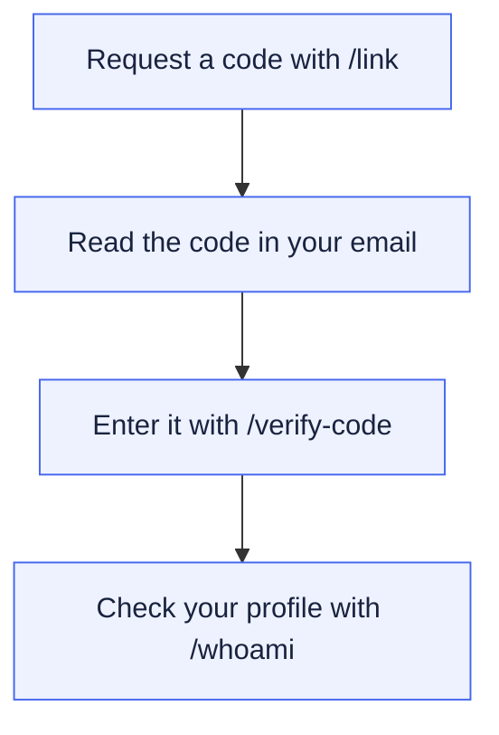
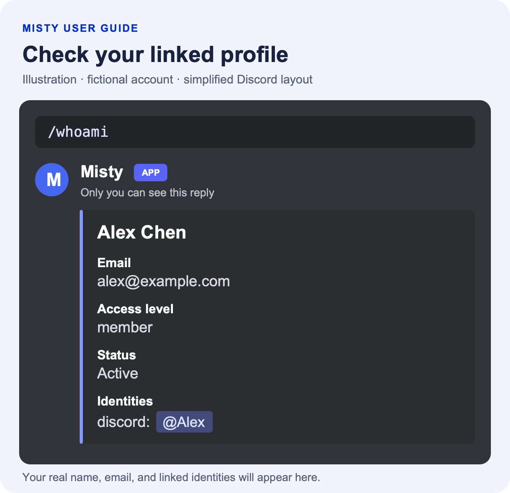

# Getting started

Before you can chat with Misty, find documents, or start a recording, link
your Discord account to your UTMIST member record. You only need to do this
once for the Misty bot you are using.

Have the email address on your member record ready, and make sure you can
open its inbox. If you do not know which email is on your record, ask an
exec or Misty admin.

## Link your Discord account



1. Open a text channel in a server where Misty is available.
2. Type `/link` and choose Misty's command. In the `email` field, enter the
   email address on your member record, then send the command.
3. Misty tells you that it has emailed a code. Open that inbox and find the
   six-digit code.
4. Return to Discord using the same account. Choose `/verify-code`, enter
   the code in the `code` field, and send it.

For example, the first command will look like this after you fill it in:

```text
/link email:you@example.com
```

When linking succeeds, Misty confirms the name of the person you are linked
as. Your link also works in other servers using the same Misty bot.

If Misty cannot find the email, ask an exec to add your member record before
trying again. If the code expires, run `/link` again to request a new one.
Enter the code through `/verify-code`; keep it out of ordinary messages.

## Check that your account is ready

1. Run `/whoami`.
2. Check the name, primary email, and linked Discord identity in the reply.
3. Run `/my-teams` to see the teams you belong to.

Both replies are visible only to you. If your profile or memberships are
incorrect, contact a Misty admin with the correction you need.

Here is an illustrated `/whoami` reply for a fictional member:

<a href="assets/profile-example.png">
  
</a>

<details>
<summary>Read the example as text</summary>

**You run:** `/whoami`

> **Misty — visible only to you**
>
> **Alex Chen**
>
> **Email:** alex@example.com
>
> **Access level:** member
>
> **Status:** Active
>
> **Identities:** discord: @Alex

Check that the profile belongs to you. Use `/my-teams` separately to view
memberships; they are not shown in this profile card.

</details>

Next, read [Teams](Teams.md) to check your memberships and understand how
they connect to Google access. You can also [talk to Misty](Talking-to-Misty.md),
[find a document](Documents.md), or [record a meeting](Meetings.md).

## Add another email

You may use one email for UTMIST and another for Google Drive. Adding the
second address helps Misty recognize documents shared with that address.
You must already be linked before doing this.

1. Choose `/add-email` and enter the additional address in the `email`
   field.
2. Open that email's inbox and find the verification code.
3. Choose `/verify-email`, enter the code, and send the command.
4. Wait for Misty to confirm that the address has been added.

This adds another verified address to your account. Your primary email
stays the same. When managed Google Groups is enabled, Misty also schedules
updates to add that address to your current teams' Groups. File owners must
still share their files with your address or the appropriate Group. See
[Use your team's Google files](Teams.md#use-your-teams-google-files).

For this task, finish with `/verify-email`. `/verify-code` is used for the
initial Discord link. If the additional-email code expires, start again
with `/add-email`. If Misty says the email belongs to another member, ask an
admin to help resolve the account records.

<details>
<summary>Example: your Google files use another email</summary>

Alex linked Discord using `alex@example.com`, but the robotics folder is
shared with `alex.drive@example.com`. Alex runs:

```text
/add-email email:alex.drive@example.com
```

Alex opens that inbox, then enters its code in `/verify-email`. Misty
confirms that the address was added. Alex can then try `/doc search` again
once Misty has processed the source's sharing. The folder must already be
shared with Alex's Google account.

</details>

## Understand your account permissions

Your `/whoami` reply includes an **access level**. Members can use the
everyday features in this guide. The team and settings changes in the
[administrator guide](Administration.md)
require `admin` or `superuser` access.

A Discord server role, a team role such as `lead`, or a team's admin flag
does not automatically give you Misty administrator access. If a task is
refused, check `/whoami` and ask a Misty admin for help.

You can still use `/help` and `/bug` before linking. Recording status,
stopping a recording, and live Q&A also work without a linked account,
subject to the [meeting channel rules](Meetings.md).
