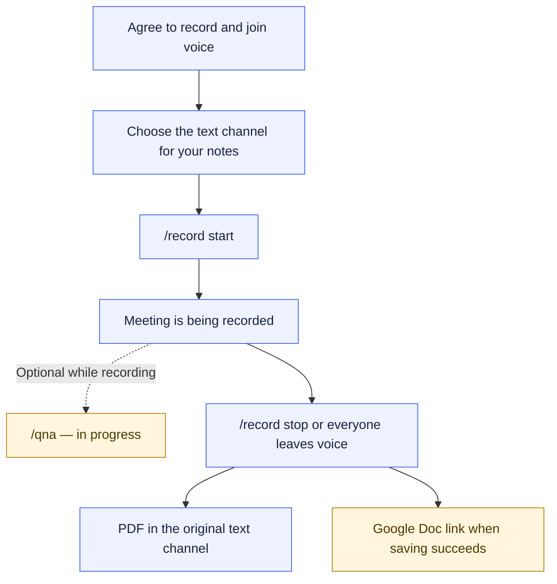
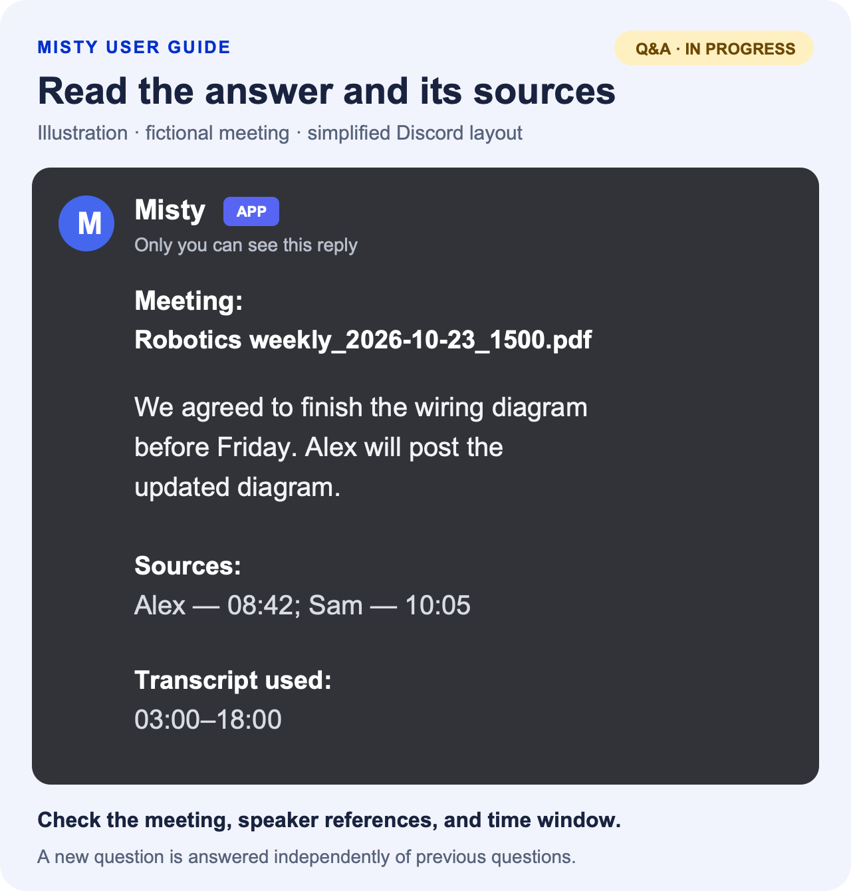

# Meetings

Misty can join your Discord voice meeting, transcribe the conversation, and
prepare notes afterward. The notes include a summary, decisions, action
items, and the full transcript.

Follow the walkthrough below to record a meeting. You can also use
[live meeting Q&A](#live-meeting-qa) while recording is active. Q&A is
available and marked **in progress**.



## Before you start

You need a [linked account](Getting-started.md) to start a recording. Join
the voice channel you want to record and make sure everyone present agrees
to recording.

Choose the text channel or thread where you want the notes to appear.
People who can read that destination will be able to read the PDF. They can
also use `/qna` there while the recording is active, even if they are not in
the voice channel.

## Start a recording

1. Stay connected to the meeting's voice channel.
2. Open the text channel or thread you chose for the notes.
3. Select `/record start`. Add a `name` if you want one, such as
   `Robotics weekly meeting`.
4. Send the command and check that Misty has joined the voice channel and
   confirmed the recording.

For example:

```text
/record start name:Robotics weekly meeting
```

The default is to save a Google Doc as well as deliver the PDF. This needs
your server's Google saving setup to be available. For a saved recording,
Misty posts a notice explaining where the transcript and minutes will be
saved and who can access the Doc.

If you want **only the PDF**, set `save` to `false` when starting:

```text
/record start name:Robotics weekly meeting save:false
```

The PDF still contains the full transcript. Misty does not save or return
an audio file.

Only one recording can run in a server at a time. If Misty says another
recording is active, use `/record status` to find out where it is before
trying to start a new one.

You may also receive a DM from Misty when you are the first person to enter
an empty voice channel. That is a prompt to use `/record start`; it does not
start a recording by itself.

## Check and stop the recording

During the meeting, run `/record status` to check the elapsed time and
Misty's voice channel.

When you are finished:

1. While still in the recorded voice channel, run `/record stop`.
2. Wait for Misty to finish preparing the minutes.
3. Return to the text channel or thread where you started the recording.

Misty also stops automatically after everyone leaves the voice channel,
following a short grace period. If that channel is already empty, you can
use `/record stop` from outside it.

You do not have to be the person who started the recording to stop it.
Status and stop work without account linking, but the voice-channel rule
for stopping still applies.

If you move Misty to another voice channel, a recording that is saving to
Google Docs ends. Start a new recording there for the new audience.
PDF-only recordings follow voice-channel moves.

## Find and read your notes

Misty posts the PDF in the original text channel or thread and mentions the
person who started the recording. Open the attachment to read the summary,
decisions, action items, and transcript. Check names and important decisions
against what was said before using the notes as a final record.

For a saved recording, Misty also posts a Google Doc link once saving
succeeds. The Doc contains the minutes and transcript, and you need your
own Google permission to open it.

Misty creates that Doc in the configured meeting-records location in Google
Drive, organized by voice channel. Use the posted link to open the record;
members are given access to the Doc, rather than the storage folder. The
record is also added to Misty's catalog and processed for authorized
document search. Processing can finish after the Doc has been saved.

The saved Doc is shared using the teams configured for the voice channel.
Members receive Commenter access through those teams' managed Google
Groups, so they can read and comment on the record.
If that access cannot be established, Misty marks the Doc **admin-only**.
Ask a Misty admin if you cannot open it. The PDF's audience is still everyone
who can read the Discord destination, including when the Doc is admin-only.

Admins should follow [Set up saved meeting access](Managing-access-and-documents.md#set-up-saved-meeting-access)
before the meeting. That guide explains the voice-channel setup and how
later changes to team membership affect existing Group shares.

If the PDF arrives but the Doc link is delayed, keep the PDF and read
Misty's notice. Pending saves and link delivery can be retried automatically.
If Misty reports a failed save or asks you to contact an admin, include the
meeting ID from the notice. Report a missing PDF separately; recovery of a
Doc link does not also recover a failed PDF post.

<details>
<summary>Example: what a meeting summary might contain</summary>

This is a fictional excerpt, not the PDF's exact layout. Your notes are
generated from the recorded conversation.

> **Robotics weekly**
>
> **Summary:** The team reviewed the demo preparation and the wiring diagram.
>
> **Decision:** Finish the wiring diagram before Friday.
>
> **Action item:** Alex will post the updated diagram for the team to review.
>
> **Transcript excerpt:** Alex: “I'll post the updated diagram before Friday.”

The actual PDF includes the full transcript as well as its generated
minutes. Check important details before treating the summary as final.

</details>

## Live meeting Q&A

**In progress.** Use Q&A to ask about what has been said
recently without waiting for the recording to finish.

1. Open the exact text channel or thread where `/record start` was used.
2. Choose `/qna` and enter your question in the `question` field.
3. Send the command and read the private reply.
4. Check the speaker and timestamp references to see which parts of the
   conversation support the answer.

For example:

```text
/qna question:What decisions have we made about the launch?
```

For a fictional robotics meeting, a question such as
`/qna question:What did we decide about the wiring diagram?` might produce
this private reply:

<a href="assets/qna-example.png">
  
</a>

<details>
<summary>Read the example as text</summary>

> **Misty — sample private answer**
>
> **Meeting: Robotics weekly_2026-10-23_1500.pdf**
>
> We agreed to finish the wiring diagram before Friday. Alex will post the
> updated diagram.
>
> **Sources:** Alex — 08:42; Sam — 10:05
>
> **Transcript used:** 03:00–18:00

The meeting label identifies the recording. Speaker timestamps point to
the speech supporting the answer, and the final line tells you how much
of the conversation was considered.

</details>

Other questions to try during a recording:

```text
/qna question:Who volunteered to prepare the demo?
/qna question:What deadline did we agree for the wiring diagram?
/qna question:What questions are still unresolved about the demo?
```

Q&A uses up to the last **15 minutes of transcribed speech**. It identifies
the meeting and time range in its reply. A busy conversation can shorten
the range; the reply tells you when that happens. If something was just
said, wait for it to be transcribed before asking about it.

Ask each question with enough context to stand on its own. Q&A does not
remember previous questions. It works only while the recording is active,
and it cannot be used in DMs. A thread and its parent channel count as
different places, so follow Misty's channel link if you ask in the wrong one.

The `/qna` slash command does not require a linked account or presence in
voice. Anyone able to use it in the recording's text channel can ask about
the meeting, and each answer is visible only to its requester. If Q&A is
busy or times out, wait briefly and try again.

## Request removal

To request removal of a meeting's saved minutes and transcript, contact a
Misty admin privately. Send the meeting ID or Google Doc link and identify
the Discord messages containing the PDF and saved link.

The admin needs to handle the saved record and the Discord copies. Deleting
only a Discord message leaves the Google Doc in place. Misty cannot recall
copies that someone has already downloaded.
