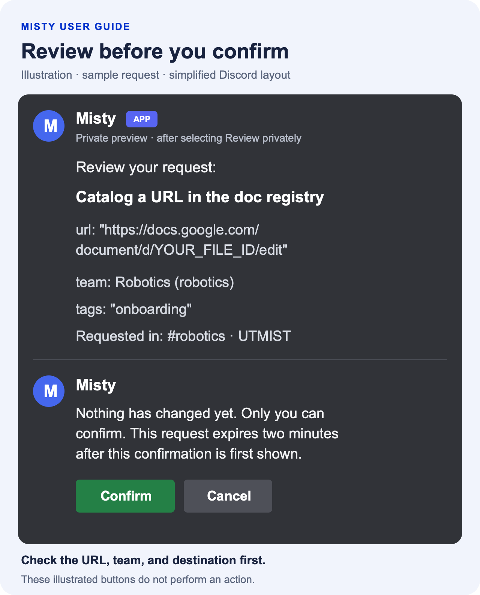

# Talking to Misty

You can ask Misty questions in a Discord channel or speak to it privately in
a direct message. [Link your account](Getting-started.md) before starting
your first conversation.

## Ask a question in a channel

1. Open the text channel where you want to have the conversation.
2. Begin your message with `@Misty`, selecting the bot's mention in Discord.
3. Write your question after the mention and send the message.
4. Open the thread Misty creates to read its answer.

For example:

```text
@Misty how do I find my team's meeting notes?
```

The thread keeps the discussion together. Other people who can read the
thread can also read the conversation, so use a DM for a personal question.

## Ask a follow-up

In the thread Misty created, use **Reply** on one of Misty's messages. Leave
the reply's mention notification enabled, write your follow-up, and send it.
You do not need to type `@Misty` again when replying this way.

If Misty does not respond, check that you replied to Misty rather than
another person and that the reply ping is on. You can also start a new
message with `@Misty`. That works when you are outside a Misty-created
thread as well.

For example, after an answer about onboarding, reply with
`Which of those steps should I do first?` If you are starting a separate
conversation, include the topic: `@Misty what should I do first in robotics onboarding?`

## Have a private conversation

Open a direct message with Misty and send your question. You can continue
with ordinary follow-up messages; no mention is needed in DMs.

Your DM conversation is separate from other users' conversations. DMs are
also the place to ask about documents available to your own account that
should not be discussed in a shared channel.

## Ask about documents

If document answers are enabled, Misty can use accessible documents to
answer your question and include links to its sources.

1. Choose a DM for documents available to you personally, or a team channel
   for information intended for that channel.
2. Name the topic or document in your question. For example:

   ```text
   @Misty what does the robotics onboarding guide say about joining meetings?
   ```

3. Read the answer and follow its source links to check the details.
4. Ask a follow-up if you need a particular point explained.

In DMs, Misty uses documents available to your linked account and can read
their full text. In a server conversation, it uses passages from documents
that your admins have made available to that channel. Threads use their
parent channel's document settings.

If a document is available in your DMs but missing in a channel, ask an
admin to check the channel's setup. Sharing an answer or a link does not
give its readers permission to open the original Google file.

If Misty cannot use documents at all, ask an admin whether document answers
are enabled. You can also try [searching for a document](Documents.md#find-a-document)
directly with `/doc search`.

<details>
<summary>More questions to try</summary>

Use a document or topic that your team has actually shared with Misty.

| Your goal | Example message |
|---|---|
| Find an instruction | `@Misty what does the robotics onboarding guide say about attending the first meeting?` |
| Summarize a document | In a DM: `Summarize the robotics onboarding guide and include the source link.` |
| Find a decision | `@Misty what did the latest saved robotics meeting notes say about the demo date?` |
| Check a detail | Reply to Misty: `Which source supports that date?` |

If Misty cannot find supporting documents, clarify the topic or ask an
admin to check access. A missing source is not evidence that a decision was
made or that a task is complete.

</details>

## Ask Misty to perform an action

When actions through chat are enabled, you can describe a supported task in
your own words. For example, ask `@Misty show my teams` or
`@Misty show the robotics roster`.

To add a document through a conversation:

1. Send `@Misty add this link to the robotics catalog and tag it onboarding:`
   followed by your document URL.
2. If you are in a server conversation, select **Review privately** to open
   the proposed action. In a DM, the preview appears there.
3. Check the document URL, team, and other details in the preview.
4. Select **Confirm** to proceed, or **Cancel** to leave things as they are.
5. Read the result to see whether the document was added or needs attention.

The private preview looks like this illustrated example. The URL is a
placeholder; your preview shows the actual URL and options Misty proposes.

<a href="assets/confirmation-example.png">
  
</a>

<details>
<summary>Read the example as text</summary>

> **Misty — private preview**
>
> Review your request:
>
> **Catalog a URL in the doc registry**
>
> url:
>
> ```text
> https://docs.google.com/document/d/YOUR_FILE_ID/edit
> ```
>
> team: **Robotics** (robotics)
>
> tags: `"onboarding"`
>
> Requested in: #robotics · UTMIST

> Nothing has changed yet. Only you can confirm. This request expires two
> minutes after this confirmation is first shown.
>
> **Confirm** · **Cancel**

The buttons in the illustration are not interactive. Use the buttons on
your actual Discord request. Selecting **Cancel** gives the reply
“Cancelled. Nothing was changed.”

</details>

Changes, including recording start and stop, require confirmation. Only the
person who requested the action can confirm it. A preview expires after
two minutes; submit a new request if it expires.

For private lookups, Misty may offer **View privately** instead. In a server,
this shows the response only to you in the same conversation. Team lists,
rosters, general help, and bug-report links can be answered publicly.

Misty applies your usual account permissions to every action. Admins can
request supported team and settings changes through chat too. Account
linking and email verification use the slash commands in
[Getting started](Getting-started.md).

If you request several changes together, review the full list and read each
result. Some changes can succeed before a later one fails. Check the
current state before repeating a request whose result is unclear.

## If Misty asks you to wait

Misty allows a limited number of helper requests per user. When you reach
the limit, its reply tells you how long to wait. Moving to another thread
does not reset the allowance, and a request can count even if its answer
fails. An admin can check the current limit for you.
